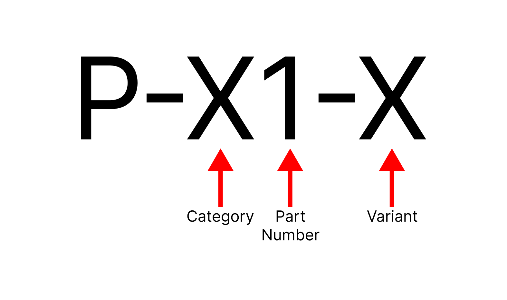

# Hydle Research Group Manufacturing Instructions & Processes

Hydle Research Group (HRG) is dedicated to manufacturing an extent of our parts locally, using desktop machines like 3D printers to achieve this.

## Guide

Parts are organized inside the `processes` folder of this repository. They are formatted like so:

- `Category`: the part category (`E` for electrical or `M` for mechanical)
- `Part Number`: the part number
- `Variant`: the part variant

Each part contains a `README.md` and a `files` folder. `README.md` is a complete guide to manufacturing that specific part, and `files` contains any necessary media/manufacturing files (e.g. STL).
