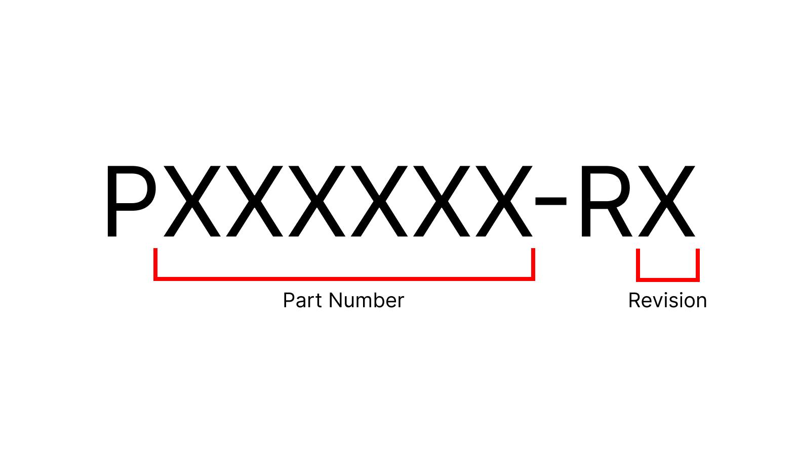

# Hydle Research Group Manufacturing Instructions & Processes

Hydle Research Group (HRG) is dedicated to keeping our part database fully open. Detailed instructions are provided for each part, so you can make the parts entirely yourself.

## Guide

Parts are organized inside the `processes` folder of this repository. They are formatted like so:

- `Part Number`: the part number
- `Revision`: the part revision

Each part contains a `README.md` and a `files` folder. `README.md` is a complete guide to manufacturing that specific part, and `files` contains any necessary media/manufacturing files (e.g. STL).
