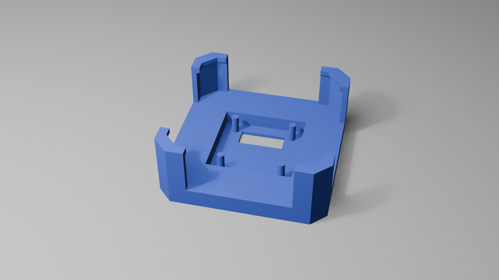

# P-M1-N17: NEMA-17 mounting part for MT6701 Magnetic Encoder modules

P-M1-N17 is a mounting piece used for MT6701 Magnetic Encoder modules, designed for the standard NEMA-17 stepper motor.

The part is designed to withstand the heat and vibrations produced by a NEMA-17, and can be made with durable filaments such as ASA or Poly-Carbonate (PC)

## Requirements

- FDM-based 3D Printer + slicing software
- ~2.83m (8.64g) of PETG filament
- 1x MT6701 Magnetic Encoder
- 1x NEMA-17 stepper motor
- Copy of `mt6701-mount.stl` (located in the `files` folder)

## Instructions

1. **Slicing & Printing**

- We recommend using adaptive layer height configured in the slicer. _If your slicer doesn't have this feature, use a 0.15-0.16mm layer height._
- The perimeter count should be set to 3.
- 15% rectilinear or cubic infill is generally considered sturdy.
- Print at a moderate speed, allowing the PETG layers to bond correctly.

2. **Installing**

- Press fit the MT6701 board onto the 4 holes, with the encoder facing outwards. Ensure the 5x2.54mm pin header is lined up with the slot in the rear of the part. You may have to press firmly, as the board snaps into place.
- Mount the P-M1-N17 on a NEMA-17 by clamping it into place on the back of the motor shaft. Ensure a dipole magnet is installed on the motor shaft (usually included with a MT6701.)

_The installation may be slightly difficult, as the P-M1-N17 clamping design holds the motor very firmly._
