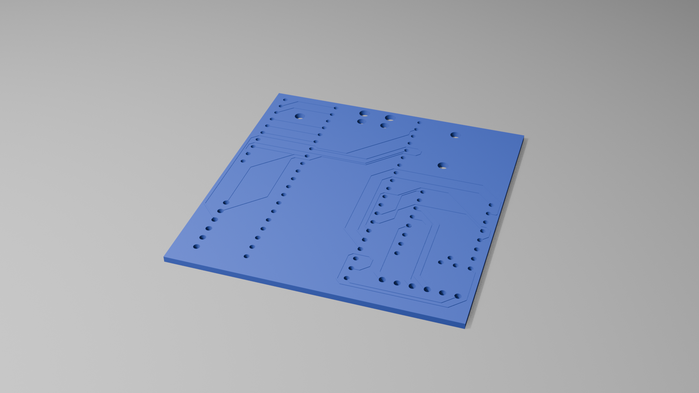
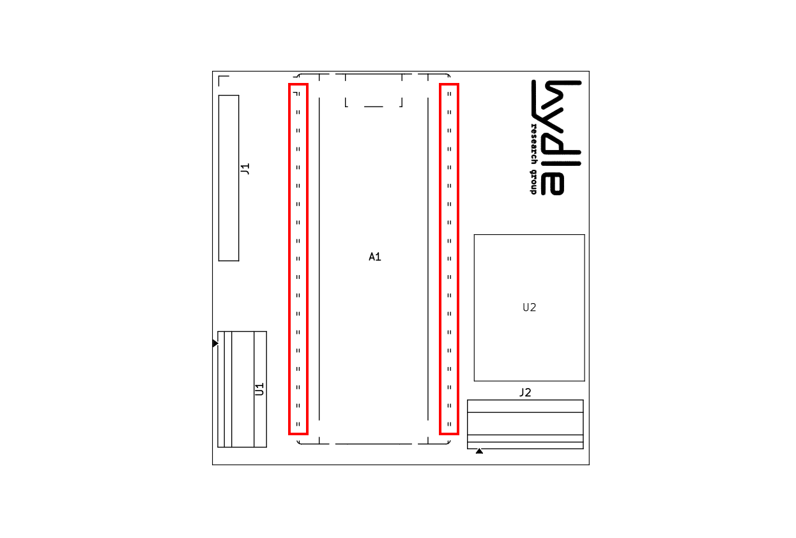
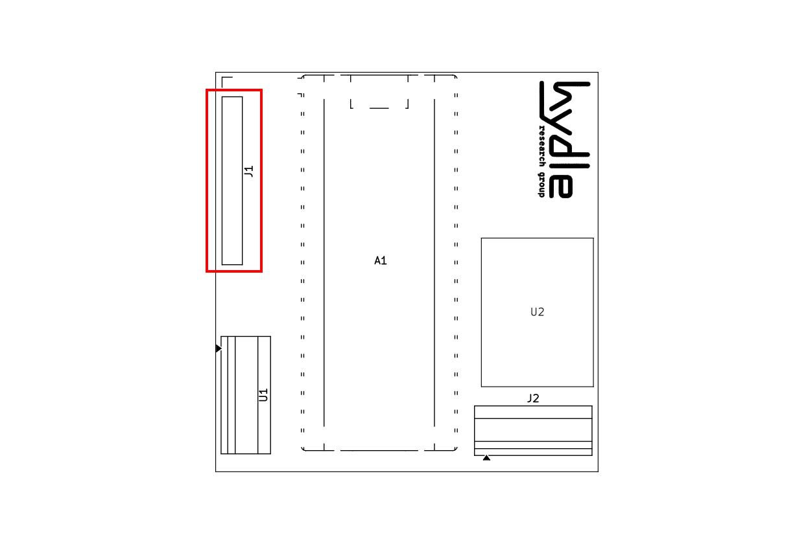
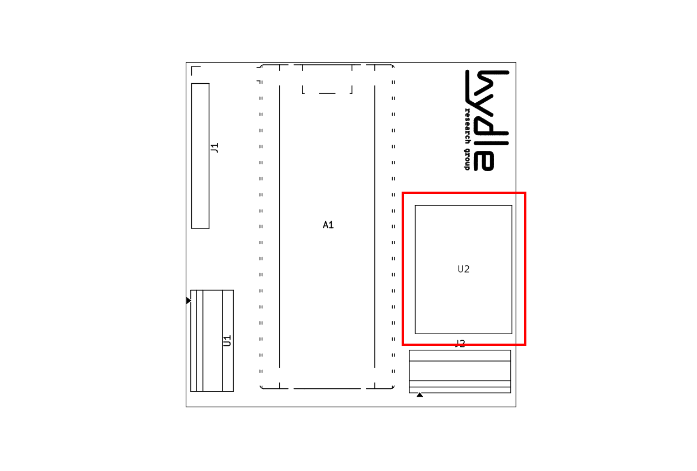
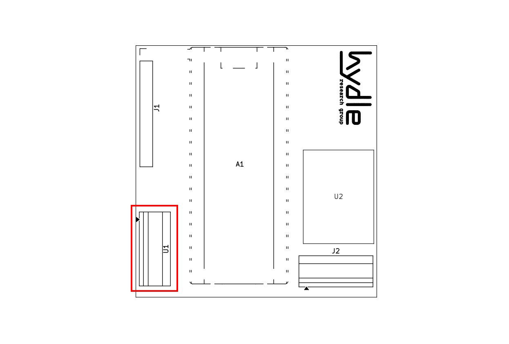
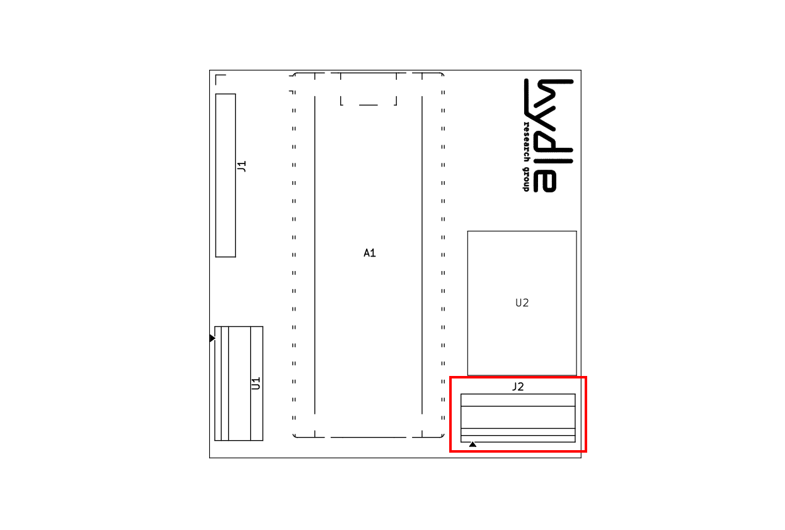

# P000002-R1: OpenPEMF PCB 

P000002-R1 is the main PCB for the OpenPEMF device. 

The part is designed to mount a Raspberry Pi Pico, TMC2209, and screw terminals for driving the OpenPEMF treatment coil.

## Requirements

- A PCB manufacturing source ([JLCPCB](https://jlcpcb.com/) or [PCBWAY](https://www.pcbway.com/) are optimal services)
- A soldering iron and wire
- 1x20 Female Pin Headers (2.54mm, Quantity: 2)
- 1x8 Female Pin Headers (2.54, Quantity: 2)
- 1x10 Male Pin Header (2.54mm)
- 1x6 Screw Terminal (2.54mm, >2A Continuous, 22-18AWG)
- 1x6 Female JST-XH Connector (2.54mm)

## Instructions 

**1. Order & Manufacture**

Download `board.zip` (located in the `files/` folder) and upload it to a PCB manufacturing service. All Gerber and Drill files are packaged in `board.zip`. 

**2. Construct The PCB**

Once the PCB is produced, you can solder all components listed above.  

Solder both of the 1x20 Female Pin Headers to **A1**.

Solder the 1x10 Male Pin Header to **J1**.

Solder both of the 1x8 Female Pin Headers to **U2**.

Solder the 1x6 Screw Terminal to **U1**.

For **J2**, you have the option to solder a 1x6 Screw Terminal or 6-pin JST (XH) Female connector. 

*We recommend soldering a JST, as OpenPEMF's primary connector uses a JST. If you prefer to hard wire OpenPEMF's treatment coil, feel free to solder a 1x6 Screw Terminal to J2 instead.* 

